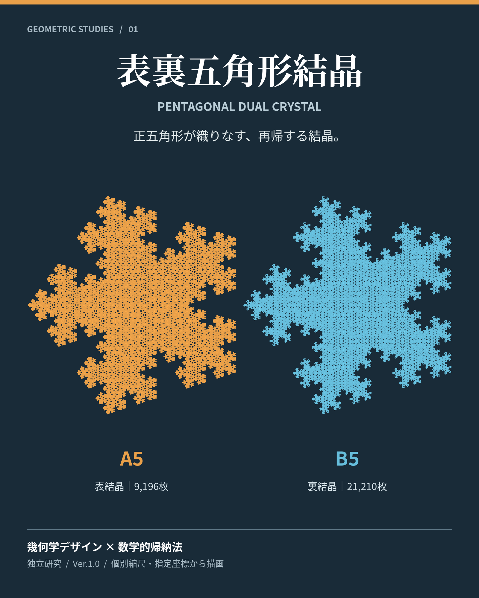

# 表裏五角形結晶 | Pentagonal Dual Crystal

[English overview](README.en.md) · **Ver.1.0** · 外部査読前の独立研究



正五角形を使った表結晶 A・裏結晶 B、および補填 a・b の再帰的な構成と接続を研究しています。指定した座標生成規則のもと、規定の原子分割について、全有限世代の面積非重複、部分辺接触・辺途中への頂点接触の排除、原子部品間の接触の10合同類への帰着を示す計算機援用証明を構成しました。

## 生成規則

初期例外 a₁（空集合）、a₂（正五角形1枚）等を除き、以下の式は所定の位置と向きでの部品の集合分解を意味します。座標・適用範囲は論文に記載されています。

- Aₙ = 6 Aₙ₋₁ + 5 aₙ₋₁
- Bₙ = 6 Bₙ₋₁ + 5 bₙ₋₁
- aₙ = 2 aₙ₋₁ + 2 Bₙ₋₂ + bₙ₋₂
- bₙ = 2 bₙ₋₁ + 2 Aₙ₋₁ + aₙ₋₁

## 資料

| 資料 | 内容 |
|---|---|
| [一般向け図解](docs/Pentagonal_Dual_Crystal_Illustrated_Guide_JA_v1.0.pdf) | 生成規則、基本10型、帰納法 |
| [数学論文](docs/Pentagonal_Dual_Crystal_Public_Paper_JA_v1.0.pdf) | 定義、主定理、有限状態証明 |
| [厳密検証付録](docs/Pentagonal_Dual_Crystal_Verification_Appendix_JA_v1.0.pdf) | 状態遷移、証明書、初期例外 |
| [証明書CSV](certificates/) | 状態・遷移・合同類の厳密データ |
| [証明コード（閲覧用）](proof/) | 原本のPythonソース |
| [完全資料ZIP](release/Pentagonal_Dual_Crystal_Integrated_Proof_JA_v1.0_bundle.zip) | Ver.1.0原本・過去版保全・再実行環境 |

## 検証手順

Python 3 の標準ライブラリのみで数理検証を実行できます。リポジトリのルートで次を実行してください。

```sh
python3 verify.py
```

この入口は原本ZIPのハッシュを確認し、一時ディレクトリに展開して原本の `verify_v10.py` を実行します。元のファイルを上書きしません。ハッシュのみの確認は `python3 verify.py --check-only`。`proof/` は閲覧用抽出であり、単独実行用の完全環境ではありません。

主証明の有限状態グラフは28状態・1,460遷移です。対称性を使わない確認では285状態・20,855遷移。これらの閉性・基底・厳密な配置等式を用いた帰納法が全世代性の根拠であり、1000世代の全図形を展開したわけではありません。

## 範囲と限界

指定座標モデルの全有限世代と規定の原子分割についての研究です。任意配置、無限極限、平面充填、等高線の連結性、状態数の最小性は対象外です。外部専門家による査読、形式証明支援系での検証、元制作画像の全画素照合は未実施です。多角形判定は別方式でも監査しましたが、生成・状態列挙などの実装の一部は共有しています。

## AI利用について

本研究ではChatGPTを、規則性の検討、証明の構築、プログラム作成、反例探索、資料作成に利用しています。外部査読済みの論文としては扱っていません。誤りや反例のご指摘を歓迎します。

## 利用条件

公開ライセンスは未指定です。再配布・改変等の許諾については、公開者が定める条件をご確認ください。
